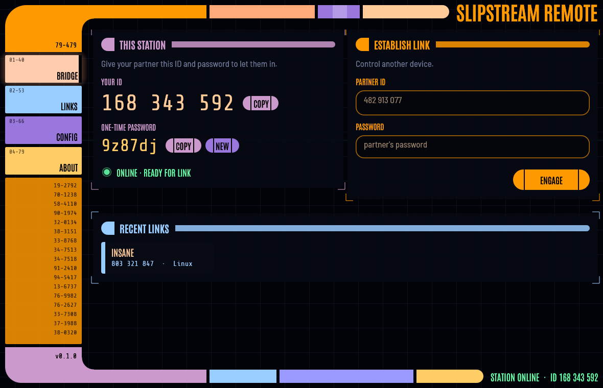

# Slipstream Remote

**Fast, free, open-source remote desktop.** Give someone your 9-digit ID and
password and they can see and control your screen — or do the same to theirs.
No accounts, no subscriptions, no telemetry. MIT licensed.



## Features

- **TeamViewer-style access** — short numeric IDs, one-time passwords that
  rotate after every session, optional permanent password for unattended access.
- **End-to-end encrypted** — every link is QUIC/TLS 1.3 between the two devices.
  Passwords are verified with SPAKE2, so they never cross the network and can't
  be brute-forced offline — not even by the server.
- **Peer-to-peer and fast** — direct connections through NAT hole punching,
  with a relay fallback. H.264 video rendered on the GPU; a frame-ack pacing
  loop keeps latency low instead of letting frames queue up.
- **Full control** — mouse, wheel, keyboard (physical keys, works across
  layouts), Ctrl+Alt+Del and other special keys, multi-monitor switching.
- **Clipboard sync, chat, and a two-pane file manager** — copy and paste
  text and files between the computers, browse both, send and receive
  folders, or drag files from your desktop straight onto the remote screen.
- **Technician sign-in** — keep your list of devices (with their passwords,
  encrypted so the station can't read them) on your station, and sign in
  to several stations at once, other organisations' too.
- **System information** — the remote computer's hardware, drives,
  temperatures and network, live.
- **Sound** from the remote computer, when you want it.
- **Unattended Windows servers** — the Slipstream service reaches UAC
  prompts, administrator windows and the login screen.
- **Privacy mode** blacks out the remote screen while you work, and
  **port forwarding** reaches services on the remote network (its Remote
  Desktop, a router's admin page).
- **Network scan** discovers devices and open TCP ports on the remote
  computer's IPv4 network, with LCARS table and logical topology views.
- **Quality presets** — Balanced, Speed, Quality, Low bandwidth; automatic
  bitrate adaptation.
- **Runs in the tray**, starts with the system, stays reachable.
- **Updates itself** from your station — upload a new build, every app
  offers *Install & restart* and keeps its settings.
- **Your own station, not a central service** — an IT firm or company runs
  one self-contained web folder: a download page with apps preconfigured for
  it, a private directory of its clients' devices, its own relay and an admin
  page. Works on ordinary PHP web hosting (Virtualmin, cPanel, …).
- A starship-console interface. 🖖

## Platforms

| | Share screen (host) | Control others (viewer) | Status |
|---|---|---|---|
| Linux — Wayland (KDE, GNOME, wlroots) | desktop portal + PipeWire | ✅ | tested (KDE) |
| Linux — X11 | MIT-SHM + XTest | ✅ | in testing |
| Windows 10/11 | DXGI + SendInput | ✅ | tested |
| macOS 12+ | ScreenCaptureKit + CGEvent (grant Screen Recording + Accessibility) | ✅ | builds (`scripts/build-macos.sh`); testing on a real Mac next |
| Android | planned (phase 2) | in development (phase 1) | runs on the emulator |

The Linux app is a single file that runs on any 64-bit distribution from
2020 on (glibc 2.31+), with no extra packages.

## Quick start

**New here? Read [docs/GETTING-STARTED.md](docs/GETTING-STARTED.md)**: a
step-by-step guide from an empty web server to your first session, including
client installs, unattended access and troubleshooting.

### 1. Set up your station (once)

Run `scripts/build-station.sh`, upload the contents of
`dist/slipstream-station/` to the root of a (sub)domain with PHP 8 and HTTPS
(e.g. `support.example.com`), and open `/admin/` to name it and set an admin
password. See [docs/GETTING-STARTED.md](docs/GETTING-STARTED.md#1-set-up-your-station).

### 2. Get the app

Download it from your station's page (`https://support.example.com/`) on
every computer — it connects to your station by itself (or with the setup
code shown on the page). Any OS can
control any other.

### 3. Connect

The **BRIDGE** page shows the computer's ID and password. On the other
computer, enter them under **Establish link** and press **Engage**.

On Wayland the first incoming session asks you to approve screen sharing;
the choice is remembered.

## Command line

```sh
slipstream                                  # the app
slipstream --connect 482913077 --password …  # connect straight away
slipstream --minimized                      # start in the tray
slipstream host [--password …]              # headless host (servers, kiosks)
slipstream connect <ID> --password …        # headless test connection with stats
slipstream set-server support.example.com --key …  # configure without the GUI
slipstream set-password <password>          # unattended-access password
slipstream info                             # show ID, station and settings path
slipstream update                           # install the newest build from your station
```

`SLIPSTREAM_HOME=/some/dir` keeps settings and identity elsewhere (handy for
running two instances on one machine).

## Building

```sh
cargo build --release
cargo test --workspace
scripts/build-station.sh     # portable Linux + Windows builds, ready to upload
```

Build dependencies, cross-compiling and the release checklist are in
[docs/BUILDING.md](docs/BUILDING.md).

## Documentation

| | |
|---|---|
| [Getting started](docs/GETTING-STARTED.md) | Station setup, installing clients, connecting, unattended access, troubleshooting |
| [Running a station](docs/SERVER.md) | Station reference: requirements, data, relay, access control, Nginx, standalone server |
| [Building and releasing](docs/BUILDING.md) | Toolchain, release builds, publishing updates |
| [Architecture](docs/ARCHITECTURE.md) | Networking, authentication, protocol, platform backends |
| [Status](docs/STATUS.md) | What's verified, known gaps, next steps |
| [Open issues](docs/issues/README.md) | The work queue, ready to file on GitHub |
| [Changelog](CHANGELOG.md) | What's in each version |
| [Code signing policy](docs/CODE-SIGNING.md) | What is signed, by whom, and privacy |

## How it works

See [docs/ARCHITECTURE.md](docs/ARCHITECTURE.md) — networking, the auth
protocol, the latency control loop and the platform backends.

## Roadmap

- Hardware video encoding (NVENC, VA-API, VideoToolbox, Media Foundation)
- Android app (viewer first, then host)

## License

MIT — see [LICENSE](LICENSE). Bundled fonts (Antonio, Barlow Semi Condensed,
Share Tech Mono) are under the SIL Open Font License 1.1; see
`apps/slipstream/assets/fonts/`.
