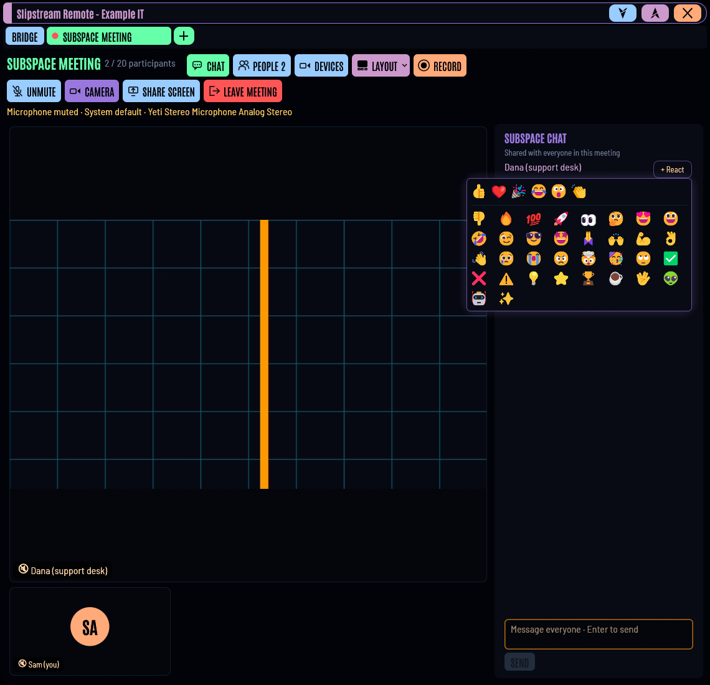

# Slipstream Remote

**Fast, free, open-source remote desktop and remote support.** Give someone
your 9-digit ID and one-time password and they can see and control your
screen, or do the same to theirs. No account, no subscription, no telemetry.
MIT licensed.

Slipstream is built for IT firms and people who are tired of paying for
TeamViewer: use the free **Slipstream Public** service straight away, or run
your own **station** (a folder on ordinary PHP web hosting) that hands out
apps preconfigured for your organisation, keeps its own device directory and
relays traffic when a direct connection isn't possible.


| Controlling another computer | Meetings, with Subspace chat and reactions |
|---|---|
|  |  |

## Download

**[Latest release →](https://github.com/Psychronic-Games/Slipstream-Remote/releases/latest)**

| You want to… | Get |
|---|---|
| Get or give help right now | The app for your system from the latest release, or from [public.slipstreamremote.com](https://public.slipstreamremote.com/). It connects through Slipstream Public. |
| Run your own private service | `slipstream-station.zip` from the latest release, then follow the **[station setup guide](docs/STATION-SETUP.md)**. |
| Install apps for your clients | Your station's own download page: those apps connect to your station by themselves. |

Every release lists its changes in the [changelog](CHANGELOG.md). Desktop apps
only install updates signed with the project's release key; stations check
the same signature before installing anything.

## Features

- **TeamViewer-style access** — short numeric IDs, one-time passwords that
  rotate after every session, optional permanent password for unattended access.
- **Scam protection** — on Slipstream Public (and on any station that asks
  for it), a link made with the one-time password waits until the person at
  the computer presses **Allow**, beside a plain warning about phone scams.
  Unattended passwords never ask.
- **End-to-end encrypted** — every link is QUIC/TLS 1.3 between the two devices.
  Remote-session passwords are verified with SPAKE2, so they never cross the
  network and can't be brute-forced offline — not even by the server.
- **Peer-to-peer and fast** — direct connections through NAT hole punching,
  with a relay fallback. H.264 video, encoded on the graphics card where
  there is one (NVIDIA NVENC; AMD and Intel through VA-API on Linux) and on
  the processor otherwise, and drawn on the GPU; a frame-ack pacing loop
  keeps latency low instead of letting frames queue up.
- **Full control** — mouse, wheel, keyboard (physical keys, works across
  layouts), Ctrl+Alt+Del and other special keys, multi-monitor switching.
- **Support tools** — connect to discovered TCP services through a workstation,
  export reviewed diagnostic reports, send LAN wake packets, compare DNS and
  gateway/station checks, and show the user a plain-language support status.
- **Cloned-device detection** — locally hashed desktop hardware evidence gives an
  imaged machine a fresh identity when it starts on different hardware, while
  retaining station and unattended settings. Run the updated master/service
  before imaging. Firmware UUID/serial identifiers take priority; Linux can
  fall back to permanent built-in PCI network adapters. Missing or duplicated
  evidence limits detection. See [imaging](docs/GETTING-STARTED.md#imaging-and-automatic-device-ids).
- **Several workstations at once** — group tabs in the console or floating
  windows, drag them between groups or tear them out without reconnecting.
  Each group's **+** opens recent or station-saved/shared devices in that window.
- **Group meetings and Show me** — authorized clients join an organizer-hosted
  room with voice, camera, chosen-screen sharing and Subspace chat. Calls
  ring as an **Incoming Transmission**; the room gets its own tab, with
  speaker and gallery layouts (double-click anyone to fill the stage), chat
  reactions, and recording to MP4 or MKV at the size and quality you choose.
  Android's rear camera can show equipment to a technician. The default room size is 20;
  usable video capacity depends on the organizer's upload connection.
  See the [meeting guide](docs/MEETINGS.md).
- **Clipboard sync, chat, and a two-pane file manager** — copy and paste
  text and files between the computers, browse both, send and receive
  folders, or drag files from your desktop straight onto the remote screen.
- **Technician sign-in** — keep your list of devices (with their passwords
  encrypted in the app before station storage) on your station, and sign in
  to several stations at once, other organisations' too. Private stations
  automatically add workstations to the shared list; passwords are still
  required to connect. Station admins sign in to the web console with their own
  technician credentials, manage several groups per workstation and inspect
  full last-reported System information, including motherboard identification.
- **System information** — the remote computer's hardware, manufacturer serial
  number (when available), drives, temperatures and network, live, plus
  peripherals, printers/scanners and network drives.
- **Sound** from the remote computer, when you want it.
- **Unattended Windows servers** — the Slipstream service hosts from boot,
  with support for UAC prompts, administrator windows and the login screen.
  Secure-desktop control still needs [real-Windows verification](docs/issues/04-windows-service.md).
- **Privacy mode** blacks out the remote screen while you work, and
  **port forwarding** reaches services on the remote network (its Remote
  Desktop, a router's admin page).
- **Network scan** discovers devices and open TCP ports on the remote
  computer's IPv4 network or a manually entered subnet/VLAN, with device
  names, LCARS table/topology views, and its own movable desktop window.
- **Quality presets** — Balanced, Speed, Quality, Low bandwidth; automatic
  bitrate adaptation.
- **Runs in the tray**, starts with the system, stays reachable.
- **Stations and apps update themselves** — stations install new signed
  releases from GitHub (automatically, or with one click on the admin page),
  and the desktop apps then offer *Install & restart*, keeping their settings. Windows app updates
  also update an installed service. Android updates
  are installed from the station's APK.
- **Works immediately, with self-hosting available** — raw downloads use
  `public.slipstreamremote.com`. A configured self-hosted station stays the
  default; shared tabs above Your ID and Establish link switch both panels
  between that station and Slipstream Public. **Link to my organisation**
  on Bridge connects an app to a station by its address or setup code.
- **Your own station** — an IT firm or company runs
  one self-contained web folder: a download page with apps preconfigured for
  it, a private directory of its clients' devices, its own relay and an admin
  page. Works on ordinary PHP web hosting (Virtualmin, cPanel, …).
- A starship-console interface. 🖖

## Platforms

| | Share screen (host) | Control others (viewer) | Status |
|---|---|---|---|
| Linux — Wayland (KDE, GNOME, wlroots) | desktop portal + PipeWire | ✅ | tested (KDE) |
| Linux — X11 | MIT-SHM + XTest | ✅ | in testing |
| Windows 10/11 | DXGI + SendInput | ✅ | tested |
| macOS 12+ (Apple Silicon and Intel) | ScreenCaptureKit + CGEvent (grant Screen Recording + Accessibility) | ✅ | one universal app, built on GitHub's Macs; runs on a real Intel Mac; sharing and control being verified |
| Android 8+ | MediaProjection + accessibility (on-device approval) | touch viewer | Android 16 emulator tested; real phones next |

The portable Linux app is a single x86_64 file targeting glibc 2.31+
(Debian 11 / Ubuntu 20.04 and newer), with no optional capture libraries
required at runtime. The older Debian-server startup check remains open.
See [status](docs/STATUS.md) for platform verification and limits.

## Quick start

1. **Download and open the app** on both computers (Windows 10/11, macOS
   12+, Linux, Android 8+). No installer and no account are needed. On a
   Mac, move it to *Applications* and choose **Open Anyway** the first time
   (it isn't notarised by Apple yet). On Linux, browsers don't keep the
   executable permission: tick *Properties → Allow executing as program*
   (or run `chmod +x` on it) before opening it.
2. On the computer that needs help, the **BRIDGE** page shows **Your ID** and
   a **one-time password**.
3. On the other computer, enter them under **Establish link** and press
   **Engage**. On Slipstream Public, the person being helped presses
   **Allow**.

For computers nobody sits at, set an **unattended password** under
**Config**; it connects without a prompt. On Windows, the optional
Slipstream service also reaches the login screen and administrator prompts.
The [getting started guide](docs/GETTING-STARTED.md) covers installing,
unattended access, the support tools and troubleshooting.

> **Beware of scams.** Nobody from a bank, Microsoft, Apple or "tech
> support" will phone you out of the blue and ask you to install a
> remote-access app. Only share your ID and password with someone you know.

## Command line

```sh
slipstream                                  # the app
slipstream --connect 482913077 --password …  # connect straight away
slipstream --minimized                      # start in the tray
slipstream host [--password …]              # headless host (servers, kiosks)
slipstream connect <ID> --password …        # headless test connection with stats
slipstream set-server support.example.com --key …  # configure without the GUI
slipstream set-password <password>          # unattended-access password
slipstream info                             # show ID, station and settings path
slipstream update                           # install the newest build from your station
```

`SLIPSTREAM_HOME=/some/dir` keeps settings and identity elsewhere (handy for
running two instances on one machine).

## Documentation

| | |
|---|---|
| [Station setup](docs/STATION-SETUP.md) | Step by step: your own station from a release, on ordinary web hosting |
| [Getting started](docs/GETTING-STARTED.md) | Installing clients, connecting, unattended access, support tools, troubleshooting |
| [Running a station](docs/SERVER.md) | Station reference: requirements, updates, data, relay, access control, Nginx, standalone server |
| [Meetings and Show me](docs/MEETINGS.md) | Calls, admission, devices, screen previews and mobile camera sharing |
| [Building and releasing](docs/BUILDING.md) | Toolchain, release builds, publishing releases |
| [Architecture](docs/ARCHITECTURE.md) | Networking, authentication, protocol, platform backends |
| [Status](docs/STATUS.md) | What's verified, known gaps, next steps |
| [Open issues](docs/issues/README.md) | The work queue |
| [Code signing policy](docs/CODE-SIGNING.md) | What is signed, by whom, and privacy |
| [Changelog](CHANGELOG.md) | What's in each version |

## Building from source

```sh
scripts/check.sh cargo build --release --locked
scripts/check.sh                # workspace tests, with resource/cache limits
scripts/build-station.sh        # portable Linux + Windows (+ Android) builds, ready to upload
```

Build dependencies, cross-compiling and the release checklist are in
[docs/BUILDING.md](docs/BUILDING.md). Contributions are welcome: open an
issue first for larger changes.

## How it works

See [docs/ARCHITECTURE.md](docs/ARCHITECTURE.md) — networking, the auth
protocol, the latency control loop and the platform backends.

## Roadmap

- Real-hardware verification: Windows service (UAC, login screen), Android
  phones, sharing and control from a Mac
- Hardware encoding: Media Foundation proven on real AMD and Intel Windows
  machines (it's opt-in until then), VideoToolbox on Macs, Android
- Android host audio/clipboard/files and self-updates
- Windows and macOS code signing

## License

MIT — see [LICENSE](LICENSE). Bundled fonts (Antonio, Barlow Semi Condensed,
Share Tech Mono) are under the SIL Open Font License 1.1; see
`apps/slipstream/assets/fonts/`.
